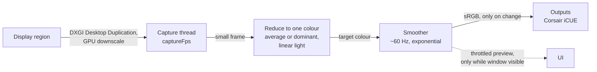

# Glowdrift

Glowdrift is a Windows 11 desktop app that watches a region of one of your displays, reduces it to a single
colour, smooths that colour over time, and sends it to ambient lighting. The smoothing is the point: the light
follows the picture with a slow, calm fade instead of flickering with every cut or flash.

## Status

Early development, pre-1.0. Everything here is subject to change.

| Area | State |
| --- | --- |
| Capture a display region (DXGI Desktop Duplication, GPU downscale) | In development |
| Average and dominant colour, exponential smoothing, brightness and saturation | In development |
| Corsair iCUE output (official iCUE SDK) | In development |
| System tray, start minimised, auto-update | In development |
| Philips Hue output | Planned |
| Virtual-display fallback for apps that can only sample a screen | Planned |

See [docs/integrations.md](docs/integrations.md) for what each lighting route does and what is implemented.

## Install

1. Open the [Releases](https://github.com/smolnetim/glowdrift/releases) page and download the latest
   `Glowdrift_<version>_x64-setup.exe`.
2. Run it. It installs for the current user only, so it does not ask for administrator rights.
3. Start Glowdrift. It lives in the system tray, and closing the window hides it rather than quitting.

Requirements: Windows 11, and Corsair iCUE running if you want to drive Corsair devices. The
WebView2 runtime that Windows 11 ships with is used for the window.

**SmartScreen warning.** Releases are not yet signed with a code-signing certificate, so Windows SmartScreen may
say it protected your PC. Choose "More info" and then "Run anyway" if you trust the download. Release files carry
build provenance attestations where the repository is public, and the updater verifies a separate signature on every
update. See [docs/updates.md](docs/updates.md).

**Updates.** Glowdrift checks GitHub Releases for new versions, downloads them in the background, and applies
them on the next restart. You can turn this off in the settings. To go back to an older version, install that
version's installer over the top.

## How it works



- Capture is cheap: the frame is shrunk on the GPU, so only a small image is read back.
- The colour is computed in linear light, which averages brightness the way your eyes see it.
- The smoother runs at a fixed output rate that is independent of the capture rate, so fades stay fluid even at
  5 captures per second.
- Outputs only receive a colour when it actually changed, and the engine sleeps when the light has settled, so the
  app idles at very low CPU.

Details are in [docs/architecture.md](docs/architecture.md).

## Supported lights

- **Corsair iCUE**: controlled directly through the official iCUE SDK. No virtual display is needed.
  iCUE must be installed and running.
- **Philips Hue** (planned): through the Hue bridge's local API.
- **Virtual display** (planned, optional): a display that other screen-sampling apps can be pointed at, for
  lights that cannot be controlled any other way.

## Privacy

- Screen content is processed in memory on your PC. Glowdrift keeps one colour value, not images, and does not
  record, store, or upload screenshots.
- The window can show a thumbnail of a monitor so you can choose a region. That thumbnail is generated locally and
  only passed to the app's own window.
- There is no telemetry. The only network request Glowdrift makes by itself is the update check against GitHub
  Releases, which you can disable.
- The configuration is a small JSON file in the app's config directory.

## Build from source

Prerequisites on Windows 11: Rust (stable, MSVC toolchain), Visual Studio 2022 Build Tools with the C++ workload and
a Windows SDK, Node.js 24 or newer, and the WebView2 runtime.

```powershell
git clone https://github.com/smolnetim/glowdrift.git
cd glowdrift

# Rust checks
cargo fmt --all --check
cargo clippy --workspace --all-targets -- -D warnings
cargo test --workspace

# Run the desktop app in development mode
cd apps/desktop
npm ci
npm run tauri -- dev

# Build the installer (NSIS)
npm run tauri -- build
```

An unsigned local build cannot produce updater artifacts unless the `TAURI_SIGNING_PRIVATE_KEY` environment variable
is set, because the bundle config enables them. See [CONTRIBUTING.md](CONTRIBUTING.md) and
[docs/releasing.md](docs/releasing.md).

## Project layout

```
crates/glowdrift-core/      Colour maths, reduction, smoothing, config schema and validation (platform independent)
crates/glowdrift-capture/   Windows monitor enumeration and DXGI Desktop Duplication capture
crates/glowdrift-outputs/   Output trait and sinks (iCUE now; Hue and virtual display later)
apps/desktop/               Tauri v2 app: React + TypeScript frontend (src/) and Rust shell (src-tauri/)
docs/                       Architecture, update policy, release process, integrations
scripts/                    Version bump and release helper scripts
.github/                    CI, security, and release workflows
```

## Contributing and security

Contributions are welcome: read [CONTRIBUTING.md](CONTRIBUTING.md). To report a vulnerability, follow
[SECURITY.md](SECURITY.md).

## Licence

[MIT](LICENSE)
