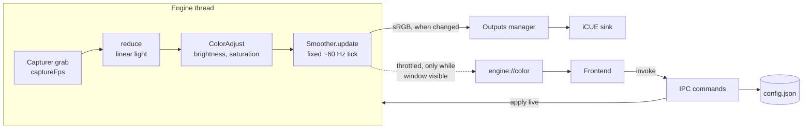

# Architecture

Glowdrift turns a region of a display into one calm colour and sends it to lights. This document describes the
crates, threads, data flow, the frontend/backend contract, the configuration schema, and what happens when
something goes wrong. Where the code and this document disagree, the code is authoritative.

## Crates

| Path | Role | Platform |
| --- | --- | --- |
| `crates/glowdrift-core` | Colour types and conversions, frame reduction (average, dominant), exponential smoother, configuration schema and validation. No I/O. | Any |
| `crates/glowdrift-capture` | Monitor enumeration and screen capture through DXGI Desktop Duplication, with a GPU downscale so only a small frame is read back. | Windows |
| `crates/glowdrift-outputs` | The `Output` trait and its sinks. The iCUE sink loads the iCUE SDK runtime library at run time. | Windows for iCUE |
| `apps/desktop/src-tauri` | Tauri v2 shell: tray, window lifecycle, IPC commands, configuration persistence, the engine thread, output management. | Windows |
| `apps/desktop/src` | React + TypeScript + Vite frontend. | WebView2 |

Dependencies point inward: the shell depends on the three crates, `capture` and `outputs` depend on `core`, and
`core` depends on nothing platform specific. The core crate stays free of I/O so the maths is unit-testable on any
machine.

## Data flow

1. The capturer grabs a small downscaled frame of the configured region at `captureFps` (1 to 60, default 20).
2. `reduce` collapses the frame to one colour in linear light, either the average or the dominant colour.
3. The colour passes through `ColorAdjust` (brightness gain, saturation).
4. The smoother advances at a fixed output rate of about 60 Hz, independent of the capture rate, moving the
   current colour toward the target with an exponential time constant (`smoothingMs`). A time constant of 0 snaps
   to the target.
5. The sRGB result is forwarded to outputs only when it changed.
6. The UI receives a throttled preview (at most about 20 events per second) only while the main window is visible.

Working in linear light matters: averaging gamma-encoded sRGB values darkens mixed colours, and fading in
linear light gives a more even perceived fade.

## Threads

| Thread | Responsibility |
| --- | --- |
| Main / Tauri runtime | Window, tray, IPC command handlers, event emission. Handlers do not block on capture or lights. |
| Engine thread | Owns the capturer, the smoother and the loop timing. Receives commands over a channel (apply config, start/stop, preview on/off, shut down). It sleeps until the next capture or smoothing deadline, and stops ticking once the output has settled at its target, so an unchanging picture costs almost no CPU. |
| Outputs poller | Polls each output's status about once per second and emits `outputs://status` when it changes. Reconnect handling lives here. |

Shared state is small: the current configuration and the last engine status, each behind a mutex. The engine
thread never waits on the UI.

## IPC contract

The TypeScript types live in `apps/desktop/src/lib/ipc.ts`. Command names are snake_case; arguments and payloads
are camelCase.

Commands (Tauri `invoke`):

| Command | Returns | Notes |
| --- | --- | --- |
| `get_config()` | `Config` | |
| `set_config(config)` | `Config` | Validates (clamps), persists, applies live, returns the stored value. |
| `list_monitors()` | `MonitorInfo[]` | `{ id, name, x, y, width, height, primary, scaleFactor }` |
| `get_monitor_thumbnail(monitorId, maxWidth)` | `{ width, height, dataUrl }` | PNG data URL of the whole monitor. `monitorId` null means the primary monitor. |
| `get_engine_status()` | `EngineStatus` | `{ running, measuredFps, lastError, raw, smoothed }` |
| `set_engine_running(running)` | `EngineStatus` | |
| `list_outputs()` | `OutputStatus[]` | `{ id, kind, name, enabled, state, detail, deviceCount }`; `state` is `connected`, `connecting`, `unavailable`, `error` or `disabled`. |
| `get_app_info()` | `{ version, name }` | |

Events (emitted by Rust):

| Event | Payload | When |
| --- | --- | --- |
| `engine://color` | `{ raw, smoothed }` as `#rrggbb` | At most about 20 per second, only while the main window is visible. |
| `engine://status` | `EngineStatus` | On change: start, stop, error, notable frame-rate change. |
| `outputs://status` | `OutputStatus[]` | On change. |

Autostart, updates and restart are not part of this contract: the frontend uses the official Tauri plugins'
JavaScript APIs (`@tauri-apps/plugin-autostart`, `@tauri-apps/plugin-updater`, `@tauri-apps/plugin-process`)
directly, with permissions granted in `apps/desktop/src-tauri/capabilities/default.json`.

The webview runs under a strict content security policy (`script-src 'self'`, `style-src 'self'`), so the frontend
uses CSS classes or sets styles from script rather than inline `style` attributes in markup.

## Configuration

`Config` is defined in `glowdrift-core`, serialised as camelCase JSON, and stored as `config.json` in the app's
config directory. Unknown fields are ignored and missing fields take their defaults, so older and newer files
both load.

| Field | Type | Default | Range / meaning |
| --- | --- | --- | --- |
| `schemaVersion` | integer | 1 | Always rewritten to the current version on validation. |
| `onboardingComplete` | bool | false | |
| `monitorId` | string or null | null | null is the primary monitor; an empty string is treated as null. |
| `region` | `{ x, y, width, height }` | full screen | Fractions 0 to 1 of the monitor, clamped, with a minimum size of 0.01. |
| `captureFps` | integer | 20 | 1 to 60 |
| `mode` | `"average"` or `"dominant"` | `"average"` | |
| `smoothingMs` | integer | 500 | 0 to 5000, exponential time constant |
| `brightness` | number | 1.0 | 0 to 1, output gain |
| `saturation` | number | 1.0 | 0 to 2 |
| `outputs.icue.enabled` | bool | true | |
| `startMinimized` | bool | true | |
| `autoUpdate` | bool | true | |

`Config::validated()` clamps every field into range. It runs on load and in `set_config`, so out-of-range values
never reach the engine.

### Schema migrations

`schemaVersion` identifies the file layout. Additive changes (new fields with defaults) do not need a version
bump. A change that renames, removes or reinterprets a field increments `schemaVersion` and ships with a
migration that upgrades older files on load. See [updates.md](updates.md) for the compatibility promise.

## Error and recovery behaviour

| Situation | Behaviour |
| --- | --- |
| Desktop Duplication access lost (resolution or display mode change, secure desktop such as UAC, display sleep, another full-screen exclusive app) | The capturer reports `AccessLost`. The engine recreates the capturer and retries with exponential backoff from 250 ms up to 2 s, then resumes. The light holds its last colour meanwhile. |
| Configured monitor no longer exists | The capturer reports `MonitorNotFound`. The error is surfaced in `EngineStatus.lastError` and the engine retries every few seconds, so reconnecting the monitor recovers without a restart. |
| Capture unsupported or other OS error | Surfaced in `lastError`; the engine retries on a slower interval rather than spinning. |
| iCUE not running, SDK library missing, or connection lost | The iCUE output reports `unavailable`, `connecting` or `error` with a `detail` string. The outputs poller notices a reconnect and the engine resends the current colour. The rest of the app keeps working. |
| An output is disabled in the settings, or the engine is paused | Outputs are released (`disabled`) and the current state is restored on resume. |
| `config.json` missing | Defaults are used. |
| `config.json` unreadable as a configuration | It is copied to `config.json.bak` and defaults are used. Valid files are validated and clamped. |
| Config writes | Written to a temporary file and then moved into place, so a crash does not leave a half-written file. |
| Second launch | The single-instance plugin focuses the existing window instead of starting another engine. |
| Update check or download fails | Handled in the frontend; it does not touch the engine, so lighting continues. |

## Window and tray lifecycle

The app lives in the system tray. Closing the window hides it; the engine keeps running. Preview events are
emitted only while the window is visible, so a hidden app does no UI work. The autostart entry passes
`--minimized`, and `startMinimized` controls whether the window is shown at launch.
