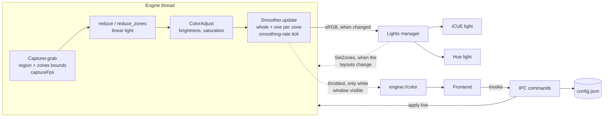

# Architecture

Glowdrift turns a region of a display into one calm colour and sends it to lights. This document describes the
crates, threads, data flow, the frontend/backend contract, the configuration schema, and what happens when
something goes wrong. Where the code and this document disagree, the code is authoritative.

## Crates

| Path | Role | Platform |
| --- | --- | --- |
| `crates/glowdrift-core` | Colour types and conversions, frame reduction (average, dominant), exponential smoother, configuration schema and validation. No I/O. | Any |
| `crates/glowdrift-capture` | Monitor enumeration and screen capture through DXGI Desktop Duplication, with a GPU downscale so only a small frame is read back. | Windows |
| `crates/glowdrift-lights` | The `Light` trait and its implementations. The iCUE light loads the iCUE SDK runtime library at run time. The Hue light talks to a Hue bridge over its local HTTPS API (CLIP v2) from its own worker thread; bridge discovery, pairing and area listing live here too. | Windows for iCUE |
| `apps/desktop/src-tauri` | Tauri v2 shell: tray, window lifecycle, IPC commands, configuration persistence, the engine thread, light management. | Windows |
| `apps/desktop/src` | React + TypeScript + Vite frontend. | WebView2 |

Dependencies point inward: the shell depends on the three crates, `capture` and `lights` depend on `core`, and
`core` depends on nothing platform specific. The core crate stays free of I/O so the maths is unit-testable on any
machine.

## Data flow

1. The capturer grabs a small downscaled frame at `captureFps` (1 to 60, default 20). Without zones that is exactly the
   configured region. With zones it is `bounding_rect(region + all zones)`, one grab per frame; the region and every
   zone are monitor fractions.
2. `reduce` collapses the frame to one colour in linear light, either the average or the dominant colour. With zones,
   `reduce_zones` reduces the region (the whole-region colour, for iCUE) and each zone from that same frame.
3. Each colour passes through `ColorAdjust` (brightness gain, saturation).
4. The whole-region colour and every zone have their own smoother with the same time constant, and the same
   settled, jump-to-target and no-consumer rules. The smoother advances at the smoothing rate, independent of the capture rate, moving the current colour toward
   the target with an exponential time constant (`smoothingMs`). A time constant of 0 snaps to the target. The
   rate is derived, not configured: the fastest of the active lights' maximum rates (`Light::min_send_interval`,
   about 30 Hz for iCUE, at most 10 Hz in total for Hue, whose interval grows with the number of lights in the area; a light with no limit gets the 60 Hz cap) and, while the preview is on, its 20 Hz. A light
   counts while it is enabled and the engine is running, even if disconnected. The step is time-based, so the time
   constant holds at any rate. With no active light and no preview nothing consumes the colour: the smoother does
   not tick and the smoothed colour follows the target directly, so a light enabled later starts from the current
   picture.
5. The sRGB results are forwarded to lights only when the whole colour or any zone colour changed (checked per
   colour). Steady state allocates nothing per frame, with or without zones.
6. The UI receives a throttled preview (at most about 20 events per second) only while the main window is visible.

### Zones

A light with per-light colours (the Hue light) implements two optional `Light` methods:

- `zone_layout() -> Option<ZoneLayout>`: `{ generation, zones }`, zones as monitor fractions. `None` (the default)
  means the light only uses the whole-region colour.
- `set_zone_colors(generation, whole, zones)`: called instead of `set_color` for a light with a layout, with the
  light's own slice of the zone colours in layout order. A `generation` that does not match the light's current layout
  falls back to `whole` for every zone.

The lights manager collects `zone_layout()` of every enabled light on its status poll (about once per second) and right
after the lights are enabled, disabled or paused, concatenates the layouts in light order, and sends
`EngineCommand::SetZones(Vec<NormRect>)` to the engine only when the combined zones changed. Colours go out with
`set_colors(whole, zones)`: a light with a layout gets its slice and generation, every other light `set_color(whole)`;
zone colours computed for a layout of another size are not applied. When a light's layout changes in a way that leaves the combined zones as they are (its generation changes), the manager asks the engine to resend the current colours, so a static picture does not leave the light on the whole colour. The engine reopens its capture session when the
zones change so every colour is recomputed even on a static desktop.

Working in linear light matters: averaging gamma-encoded sRGB values darkens mixed colours, and fading in
linear light gives a more even perceived fade.

## Threads

| Thread | Responsibility |
| --- | --- |
| Main / Tauri runtime | Window, tray, IPC command handlers, event emission. Handlers do not block on capture or lights. |
| Engine thread | Owns the capturer, the smoothers and the loop timing. Receives commands over a channel (apply config, start/stop, preview on/off, set zones, shut down). It sleeps until the next capture or smoothing deadline, and stops ticking once the smoothed colour has settled at its target, so an unchanging picture costs almost no CPU. |
| Hue worker | Owns all Hue bridge I/O: connecting, the pinned TLS connection, paced light updates (latest colour wins, never queued). `set_color` and retargeting only hand values over and never block. |
| Lights poller | Polls each light's status about once per second and emits `lights://status` when it changes. Reconnect handling lives here. |

Shared state is small: the current configuration and the last engine status, each behind a mutex, plus the Hue state (the Hue light's handle and the decrypted bridge credentials read at startup, updated on pairing and forgetting). The engine
thread never waits on the UI.

## IPC contract

The TypeScript types live in `apps/desktop/src/lib/ipc.ts`. Command names are snake_case; arguments and payloads
are camelCase.

Commands (Tauri `invoke`):

| Command | Returns | Notes |
| --- | --- | --- |
| `get_config()` | `Config` | |
| `set_config(config)` | `Config` | Validates (clamps), persists, applies live, returns the stored value. |
| `list_monitors()` | `MonitorInfo[]` | `{ id, name, x, y, width, height, primary, scaleFactor }` |
| `get_monitor_thumbnail(monitorId, maxWidth)` | `{ width, height, dataUrl }` | PNG data URL of the whole monitor. `monitorId` null means the primary monitor. |
| `get_engine_status()` | `EngineStatus` | `{ running, measuredFps, lastError, target, smoothed }` |
| `set_engine_running(running)` | `EngineStatus` | |
| `list_lights()` | `LightStatus[]` | `{ id, kind, name, enabled, state, detail, deviceCount, code? }`; `state` is `connected`, `connecting`, `unavailable`, `error` or `disabled`. `code` is an optional machine-readable cause: `libraryMissing` (the iCUE SDK library is not installed), `notPaired` or `noArea` (the Hue light has no paired bridge or no selected area). |
| `install_icue_sdk()` | `LightStatus[]` | Downloads the pinned iCUE SDK release from GitHub, verifies it and installs the library, then makes the iCUE light retry loading. Returns the statuses after the retry. Rejects with a user-presentable message. See [integrations.md](integrations.md). |
| `hue_discover()` | `BridgeCandidate[]` | Finds bridges by mDNS with a cloud fallback (about 4 s). `{ id, address, name }` |
| `hue_probe(address)` | `BridgeCandidate` | Reads a manually entered address. |
| `hue_pair(address)` | `HueBridge` | Polls the bridge every 2 s for up to 30 s until its link button is pressed. On success stores the credentials, sets `lights.hue.bridgeId` (and clears `areaId` if the bridge changed) and points the Hue light at the bridge. Rejects with "The link button was not pressed in time." on timeout. `HueBridge` is `{ id, address, name }`. |
| `hue_bridge()` | `HueBridge` or null | The paired bridge whose id matches `lights.hue.bridgeId`; no secrets. |
| `hue_list_areas()` | `HueArea[]` | Entertainment areas of the paired bridge: `{ id, kind, name, lightCount }`. Rejects when no bridge is paired. |
| `hue_list_lights()` | `BridgeLight[]` | Lights of the paired bridge that can be added as extra lights, leaving out those of the selected area: `{ id, name }`, colour-capable first. Rejects when no bridge is paired. |
| `hue_area_lights()` | `AreaLightZone[]` | The lights the Hue light drives (entertainment area, then extra lights) with the zone each samples: `{ id, name, position, zone, custom, source }`; `position` is the entertainment position or null, `zone` a monitor-fraction rect (the override, else the default), `custom` whether `zone` is an override, `source` is `entertainment` or `extra`. Answered from the light's resolved state without I/O; empty until the area is resolved. |
| `hue_select_area(areaId)` | `Config` | Persists `lights.hue.areaId` and retargets the Hue light. Rejects when no bridge is paired. A stored `areaId` that is not an entertainment area simply shows `noArea`; no migration. |
| `hue_forget()` | `Config` | Deletes the stored credentials and clears `bridgeId` and `areaId`. |
| `stage_update()` | `string` or null | Checks for an update, downloads and verifies it, and stages it. Returns the staged version, or null when up to date. |
| `install_pending_update()` | `boolean` | Installs the staged update; false when none is staged. On Windows a successful install ends the process after the engine and lights are stopped. |
| `frontend_ready()` | nothing | Sent once after the first screen is painted; the shell then shows the main window (unless it is starting minimised). |
| `get_app_info()` | `{ version, name }` | |

Events (emitted by Rust):

| Event | Payload | When |
| --- | --- | --- |
| `engine://color` | `{ target, smoothed, zones }`; `target` and `smoothed` are `#rrggbb`, `zones` is the smoothed `{ r, g, b }` colour of each light zone in layout order (the order of `hue_area_lights`), empty without zones | At most about 20 per second, only while the main window is visible. |
| `engine://status` | `EngineStatus` | On change: start, stop, error, notable frame-rate change. |
| `lights://status` | `LightStatus[]` | On change. |
| `updater://ready` | `{ version }` | An update was downloaded and staged. |

Autostart uses the official Tauri plugin's JavaScript API (`@tauri-apps/plugin-autostart`). The update check calls
the updater plugin's `check` (`@tauri-apps/plugin-updater`) and the fallback restart uses
`@tauri-apps/plugin-process`; the permissions granted in `apps/desktop/src-tauri/capabilities/default.json` are
limited to those calls (`updater:allow-check`, `process:allow-restart`, autostart enable, disable and status).
Downloading and installing an update goes through `stage_update` and `install_pending_update` instead of the
plugin's own installer, so the engine and lights are stopped before the installer starts. A failed install keeps
the update staged and rejects with a message, so the restart button can be pressed again.

The webview runs under a strict content security policy (`script-src 'self'`, `style-src 'self'`), so the frontend
uses CSS classes or sets styles from script rather than inline `style` attributes in markup.

## Configuration

`Config` is defined in `glowdrift-core`, serialised as camelCase JSON, and stored as `config.json` in the app's
config directory. Unknown fields are ignored and missing fields take their defaults, so older and newer files
both load.

| Field | Type | Default | Range / meaning |
| --- | --- | --- | --- |
| `schemaVersion` | integer | 1 | Always rewritten to the current version on validation. |
| `onboardingComplete` | bool | false | |
| `monitorId` | string or null | null | null is the primary monitor; an empty string is treated as null. |
| `region` | `{ x, y, width, height }` | full screen | Fractions 0 to 1 of the monitor, clamped, with a minimum size of 0.01. The whole-region colour (iCUE) comes from it. |
| `captureFps` | integer | 20 | 1 to 60 |
| `mode` | `"average"` or `"dominant"` | `"average"` | |
| `smoothingMs` | integer | 500 | 0 to 5000, exponential time constant |
| `brightness` | number | 1.0 | 0 to 1, brightness gain |
| `saturation` | number | 1.0 | 0 to 2 |
| `lights.icue.enabled` | bool | true | |
| `lights.hue.enabled` | bool | false | |
| `lights.hue.bridgeId` | string or null | null | Identifier of the paired Hue bridge; empty or whitespace-only is treated as null. A value of the wrong type takes the default. Bridge credentials are not stored here. Only the Hue commands change it; `set_config` keeps the stored value. |
| `lights.hue.areaId` | string or null | null | Selected Hue entertainment area; normalised and protected from `set_config` like `bridgeId`. An id that is not an entertainment area is kept but yields `noArea`. |
| `lights.hue.zones` | map of light id to `{ x, y, width, height }` | `{}` | Per-light zone overrides, fractions of the monitor, clamped like `region`; applied live to the Hue light. Lights without an entry use a default zone from their entertainment position. Invalid entries are dropped. `set_config` takes this from the sent config. |
| `lights.hue.extraLights` | string array | `[]` | Ids of single bridge lights driven in addition to the area, with a default centred zone; trimmed, de-duplicated, non-strings dropped. `set_config` takes this from the sent config; applied live to the Hue light. |
| `startMinimized` | bool | true | |
| `autoUpdate` | bool | true | |

Hue bridge credentials (app key, client key, address, certificate pin, bridge id) are never in `config.json`. They
are stored as `hue-bridge.bin` in the app data directory, encrypted with DPAPI for the current Windows user. At
startup they count only if their bridge id equals `lights.hue.bridgeId`; a store that cannot be decrypted is logged
and treated as not paired.

`Config::validated()` clamps every field into range. It runs on load and in `set_config`, so out-of-range values
never reach the engine.

### Schema migrations

`schemaVersion` identifies the file layout. Additive changes (new fields with defaults) do not need a version
bump. A change that renames, removes or reinterprets a field increments `schemaVersion` and ships with a
migration that upgrades older files on load. See [updates.md](updates.md) for the compatibility promise.

## Error and recovery behaviour

| Situation | Behaviour |
| --- | --- |
| Desktop Duplication access lost (resolution or display mode change, secure desktop such as UAC, display sleep, another full-screen exclusive app) | The capturer reports `AccessLost`. The engine recreates the capturer and retries with exponential backoff from 250 ms up to 2 s, then resumes. The light holds its last colour meanwhile. |
| Configured monitor no longer exists | The capturer reports `MonitorNotFound`. The error is surfaced in `EngineStatus.lastError` and the engine retries every few seconds, so reconnecting the monitor recovers without a restart. |
| Capture unsupported or other OS error | Surfaced in `lastError`; the engine retries on a slower interval rather than spinning. |
| iCUE not running, SDK library missing, or connection lost | The iCUE light reports `unavailable`, `connecting` or `error` with a `detail` string; a missing library also sets `code: "libraryMissing"`, which the UI answers with a download button (`install_icue_sdk`). The lights poller notices a reconnect and the engine resends the current colour. The rest of the app keeps working. |
| Hue bridge unreachable, certificate changed, credentials rejected, or neither an entertainment area nor an extra light selected | The Hue light reports `unavailable`, `connecting` or `error` with a `detail` string; no bridge or no area sets `code: "notPaired"` or `"noArea"`. The worker retries in the background and the engine resends the current colour after a reconnect. |
| A light is disabled in the settings, or the engine is paused | Lights are released (`disabled`) and the current state is restored on resume. |
| `config.json` missing | Defaults are used. |
| `config.json` unreadable as a configuration | It is copied to `config.json.bak` and defaults are used. Valid files are validated and clamped. |
| Config writes | Written to a temporary file and then moved into place, so a crash does not leave a half-written file. |
| Second launch | The single-instance plugin focuses the existing window instead of starting another engine. |
| Update check or download fails | Does not touch the engine, so lighting continues. A missing release or no network is logged at debug level; other failures at warning level. After consecutive failed background checks the interval doubles (6 h, 12 h, 24 h, 48 h at most) until a check succeeds. |
| Update install fails | The staged update is kept, the error is shown next to the restart button and the install can be retried. If the installer had already been reached, the engine and lights were stopped and stay off until Glowdrift restarts. |
| Library download fails | The error is shown next to the download button and nothing is written; a checksum mismatch discards the download. |

## Window and tray lifecycle

The app lives in the system tray. Closing the window hides it; the engine keeps running. Preview events are
emitted only while the window is visible, so a hidden app does no UI work. The autostart entry passes
`--minimized`, and `startMinimized` controls whether the window is shown at launch.

The main window stays hidden until the frontend calls `frontend_ready` after painting its first screen (or after 4
seconds, whichever comes first), so no blank frame is shown. When the app starts minimised the window is never shown
automatically.

Tray: a left click toggles the window, a right click opens the menu (Open, Pause or Resume, Check for updates, Quit).
The Pause/Resume label follows the engine's running state.

### Shutdown

Every exit path stops the engine and releases iCUE control before the process ends:

| Path | How |
| --- | --- |
| Tray Quit | Stops the engine and lights, then exits. |
| `--quit` | A second launch with `--quit` is forwarded by the single-instance plugin to the running instance, which quits as above and exits within a few seconds. With no running instance the launched process exits immediately. |
| Window close request while quitting | Once shutdown has begun, a close request is no longer turned into "hide", so the window and process can finish exiting. |
| Windows logoff or shutdown | The event loop receives the session-end message and runs the exit handler, which stops the engine and lights. |
| Update install and restart | The updater's before-exit hook and the process plugin's restart both stop the engine and lights first. |

An orderly shutdown logs `lights released` (the engine thread releases the lights as it stops) and then `engine stopped` at info level. The installer also uses `--quit` to stop a running instance before replacing its files (see [updates.md](updates.md)).
